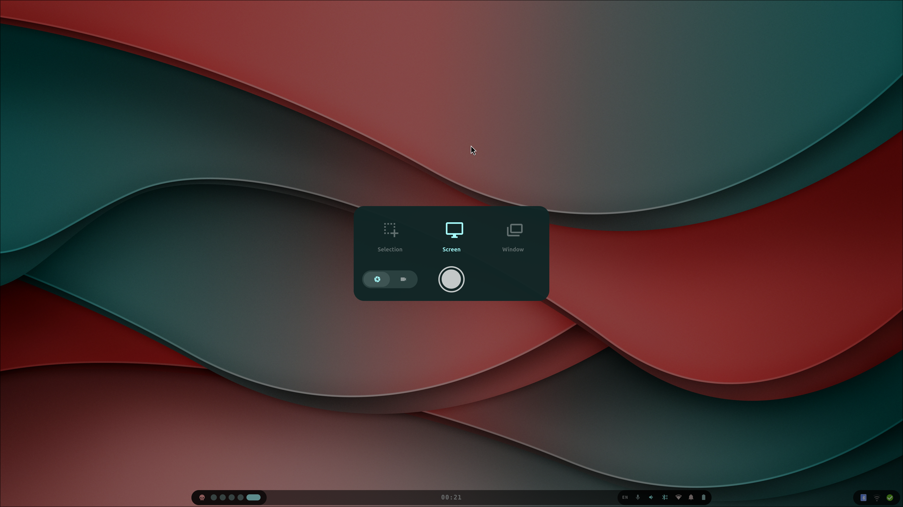

# Capture

A centered overlay for screenshots and screen recordings. Toggle with **`Print`**.

- **Mode cards** — Selection (region), Screen, or Window
- **Kind toggle** — screenshot (󰄄) or video (󰕧)
- **Shutter** — captures the current mode/kind; while recording it turns red and
  acts as a stop button. **`Space`** or **`Enter`** also fires the shutter.
- **Recording options** — toggle microphone capture and a `wshowkeys` key-press
  overlay for videos.
- **Annotate** (󰏫, screenshots, on by default) — opens the captured PNG in a
  floating editor window (Hyprland rule: centered, 80% of the monitor): pen `P`, box `B`/`R`, ellipse `E`/`O` (hold **Shift** for a
  square/circle), text `T`; colors `1`–`6`, thickness `[` / `]`, undo `Ctrl+Z`,
  redo `Ctrl+Shift+Z`/`Ctrl+Y`. **Enter**/`Ctrl+S` saves over the screenshot and
  copies it; `Ctrl+C` copies only; **Esc** closes (twice to discard edits).
  The original is already saved and copied before the editor opens.

`Esc` or a click outside the panel closes it. The actual work is done by
[`~/.config/hypr/scripts/capture.sh`](../../../../../hyprland/.config/hypr/scripts/capture.sh)
`<kind> <mode> [mic|no-mic] [keys|no-keys] [annotate|no-annotate]` (and `capture.sh stop`).
The editor is `scripts/screenshot-annotate.py` (system Python GTK4, no extra
packages). Tests: `/usr/bin/python3 -B scripts/test_screenshot_annotate.py` and
`xvfb-run -a env GDK_BACKEND=x11 /usr/bin/python3 -B scripts/smoke_screenshot_annotate.py`.
